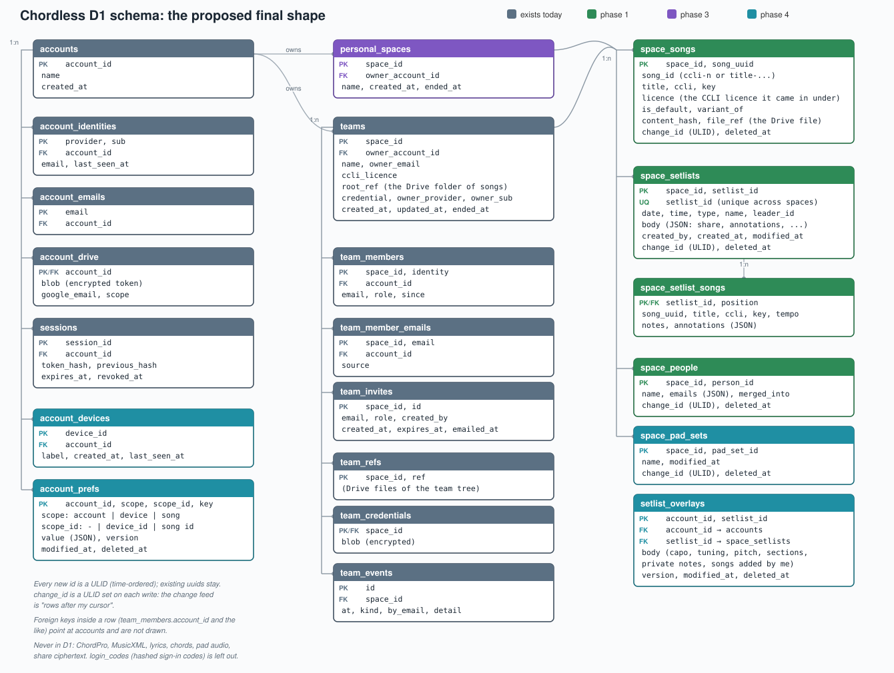

# The D1 schema: the proposed final shape

Grey tables exist today (`migrations/0001` to `0010`); the colours are the phase that adds each one
([CENTRAL_STORAGE.md](CENTRAL_STORAGE.md), [D1_PHASE1_PLAN.md](D1_PHASE1_PLAN.md)). Foreign keys inside a
row (`team_members.account_id` and the like) point at `accounts` and are not drawn.

Choices worth reviewing:

- **One generic `space_docs` for the shared records**, keyed `(space_id, collection, doc_id)`, with the
  record as JSON in `body`. It is what the storage seam already shapes (a file with props, a rev, a
  tombstone), so the sync engine needs no new idea. The cost is that D1 cannot query inside `body` cheaply:
  the one query that needs it (the CCLI usage report) reads the derived `setlist_entries`.
- **`seq` per space** is the change feed's position, taken from `space_seq`, not `modified_at`, which can tie.
- **`space_docs.space_id` points at either `teams` or `personal_spaces`.** A polymorphic key, which SQLite does
  not enforce; the Worker checks the space exists and who may write it. The alternative is one `spaces`
  table with a `kind`, and `teams` as its detail: cleaner, but it moves the register, which outlives its
  teams on purpose.
- **Setlist ids are unique across spaces**: the unique index on `doc_id` where `collection = 'setlists'`.
- **`setlist_entries` is derived**, rebuilt in the same batch as each setlist write, so the CCLI report is a
  plain join. It holds no more than the setlist already does (`title`, `ccli`, `key`).
- **Preferences are per key** (`account_prefs`) so two devices changing different settings do not
  overwrite each other; hardware settings hang off `account_devices`. **Overlays are per setlist**
  (`setlist_overlays`), and only the owning account can read or write its rows, in a Team too.
- **`teams.root_ref` and `team_refs` stay**, for the Drive folder that still holds songs and pads. The
  proposed `teams.storage_v2` is only for the move and is not in the final shape.
